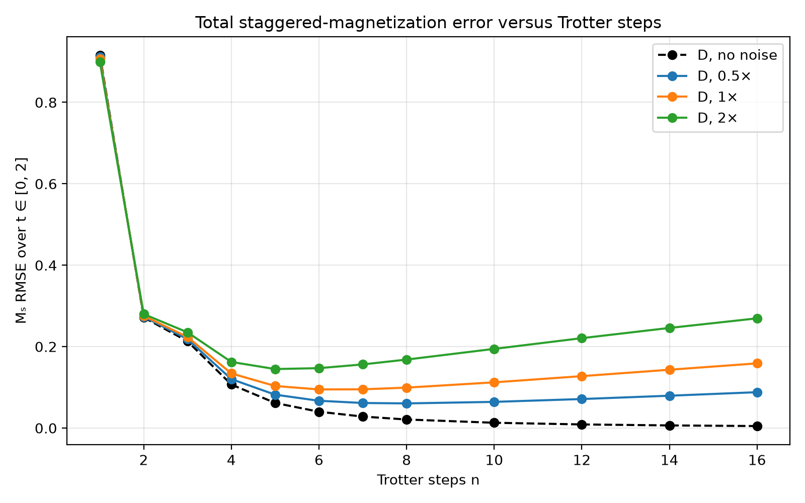

# QFF 2026 · Phase 2
## Quantum Simulation Track — PS-S3

**Team:** Entangled Minds
**Challenge:** Trotter error versus noise
**Status:** Required PS-S3 runs, shared Bell experiment, Processor D validation,
and supplementary error analysis completed locally.

> **Headline:** For the locked four-spin ring at \(T=2\), the best tested
> first-order Trotter step counts by the official noisy-fidelity criterion are
> \(n^*=6\) on A, \(7\) on B, and \(8\) on D. On D, the selected count changes
> from 8 at 0.5× noise to 7 at 2× noise.

## Results at a glance

| Processor | Noise scale | Best tested \(n^*\) | Noisy fidelity at \(n^*\) |
|---|---:|---:|---:|
| A | 1× | 6 | 0.5774 |
| B | 1× | 7 | 0.6628 |
| D | 0.5× | 8 | 0.8415 |
| D | 1× | 8 | 0.7528 |
| D | 2× | 7 | 0.6207 |

These are maxima over the prescribed discrete grid, not continuous or
hardware optima. The exact reference staggered magnetization is
\(M_s(T=2)=0.65244\). Results use the official synthetic noise model; no
quantum-hardware execution is claimed.

## Contents

- [Experiment](#experiment)
- [Key findings](#key-findings)
- [Reproduce](#reproduce)
- [Outputs](#outputs)
- [Limitations](#limitations)
- [AI assistance](#ai-assistance)

## Experiment

The locked Hamiltonian is the periodic four-site TFIM
\[
H=-J\sum_{i=0}^{3}Z_iZ_{(i+1)\bmod 4}-g\sum_{i=0}^{3}X_i,
\qquad J=g=1,
\]
initialized in the Néel state `1010` and evolved to \(T=2\) by first-order
Trotterization. The required step grid is
`1, 2, 3, 4, 5, 6, 7, 8, 10, 12, 14, 16`.

The official comparison reports density-matrix fidelity against the exact
state, \(M_s\) from 4,096 noisy shots, and logical versus routing two-qubit
gates. D is also tested at 0.5× and 2× noise. Required settings are kept
unchanged: A/B use the official `rz/sx/x/cx` basis, D uses its approved
`rz/sx/x/rzz` basis, \(p_1=0.001\), \(p_2=0.005\), readout bit-flip
probability 0.01, seed 42, and optimization level 1. The organizer-provided
[`qff_sim.py`](./qff_sim.py) is unchanged.

The separate, clearly labeled time-resolved analysis samples nine times in
\([0,2]\) and decomposes staggered-magnetization error into ideal Trotter,
noise-induced, and total errors. It uses deterministic density-matrix
expectations with readout excluded. Its observable-RMSE optimum is a
supplementary metric and does **not** replace the official \(n^*\), which is
defined by the required noisy state fidelity at \(T=2\).

## Key findings

- At each 1× fidelity optimum, A uses 81 two-qubit gates (48 logical plus
  33 routing), B uses 56 with no routing, and D uses 32 with no routing.
- D's ring connectivity avoids the routing overhead measured on A; its
  native RZZ basis also lowers the logical two-qubit count. This conclusion
  depends on the assumed RZZ error rate matching the official CX rate.
- The exact result is calculated from the locked challenge operator, which
  the pipeline checks against the organizer's Hamiltonian builder.
- The report distinguishes noisy fidelity from the shot-based observable
  and documents the assumptions, uncertainty, mitigation cost, and limits.

See the [judge-facing report](./report.md) for the Bell-state table, D design
justification, measured resources, figures, error analysis, and discussion.

### Supplementary observable-RMSE check

The additional nine-time-point \(M_s\) analysis selects a different optimum
because it minimizes a different metric. It is not a replacement for the
official fidelity-based \(n^*\).

| Processor / noise | Lowest-\(M_s\)-RMSE steps | \(M_s\) RMSE |
|---|---:|---:|
| D / no noise | 16 | 0.00487 |
| D / 0.5× | 8 | 0.06049 |
| D / 1× | 6 | 0.09482 |
| D / 2× | 5 | 0.14492 |

This plot is based on \(M_s\) RMSE over nine times, a different objective
from the official fidelity-at-\(T=2\) benchmark.



## Reproduce

Tested with Python 3.12.10 on Windows 11.

### Windows PowerShell

```powershell
py -3.12 -m venv .venv
.\.venv\Scripts\Activate.ps1
python -m pip install -r requirements.txt
python -m jupyter notebook
```

Open `main.ipynb`, then choose **Kernel → Restart Kernel and Run All Cells**.
The notebook recomputes the official scan and supplementary analysis,
regenerates the figures, and writes the environment record.

To run without opening Jupyter:

```powershell
python s3_pipeline.py
```

After a complete run has saved the scan and resources, `RECOMPUTE = False`
in the notebook can reuse those two files; keep it `True` if results are
missing or stale. A fresh setup should install the pinned packages from
[`requirements.txt`](./requirements.txt).

Run the focused correctness checks with:

```powershell
python -m unittest discover -s tests -v
```

## Outputs

| Path | Contents |
|---|---|
| [`main.ipynb`](./main.ipynb) | End-to-end reproducible notebook |
| [`s3_pipeline.py`](./s3_pipeline.py) | Official benchmark orchestration and supplementary analysis |
| [`processors/processor_D.json`](./processors/processor_D.json) | Validated six-qubit ring-plus-tail proposal |
| [`data/s3/`](./data/s3/) | Locked PS-S3 operator |
| [`results/tables/`](./results/tables/) | Required benchmark tables and supplementary raw/summary error tables |
| [`results/figures/`](./results/figures/) | Required figures plus time-resolved error and resource plots |
| [`results/environment.json`](./results/environment.json) | Runtime and official benchmark settings |
| [`report.md`](./report.md) | Full results, interpretation, and limitations |
| [`tests/`](./tests/) | Focused exact-reference and density-matrix checks |

The required tables are `s3_scan.csv`, `s3_summary.csv`, `resources.csv`,
and `bell.csv`. `mitigation.csv` records the optional readout-correction
bonus. Supplementary results are `s3_error_analysis.csv` and
`s3_error_summary.csv` ([raw time-series](./results/tables/s3_error_analysis.csv),
[RMSE summary](./results/tables/s3_error_summary.csv)).

## Limitations

This is a four-spin, one-Hamiltonian, one-time, first-order Trotter study
under a synthetic simulator noise model. Processor D is a proposal, not
hardware. The results do not establish a universal best step count or real
device performance; the RZZ-versus-CX comparison assumes identical official
per-gate error rates.

## AI assistance

GitHub Copilot was used in this final audit, for a targeted progress-log fix,
and to prepare this README and report. The reported results were generated
by running the project pipeline and checked against the challenge table
schemas and Processor D rules. Any AI tools used earlier in project
development must also be disclosed by the team before submission; this
statement does not claim that no other tools were used.
