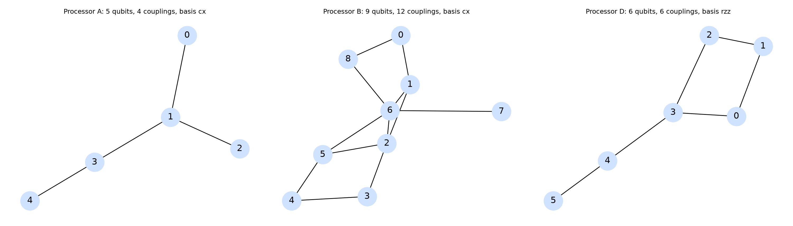
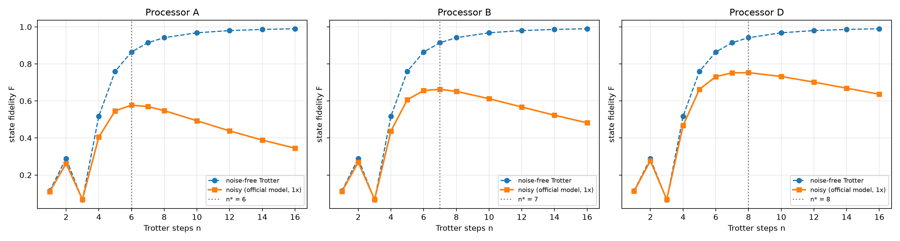
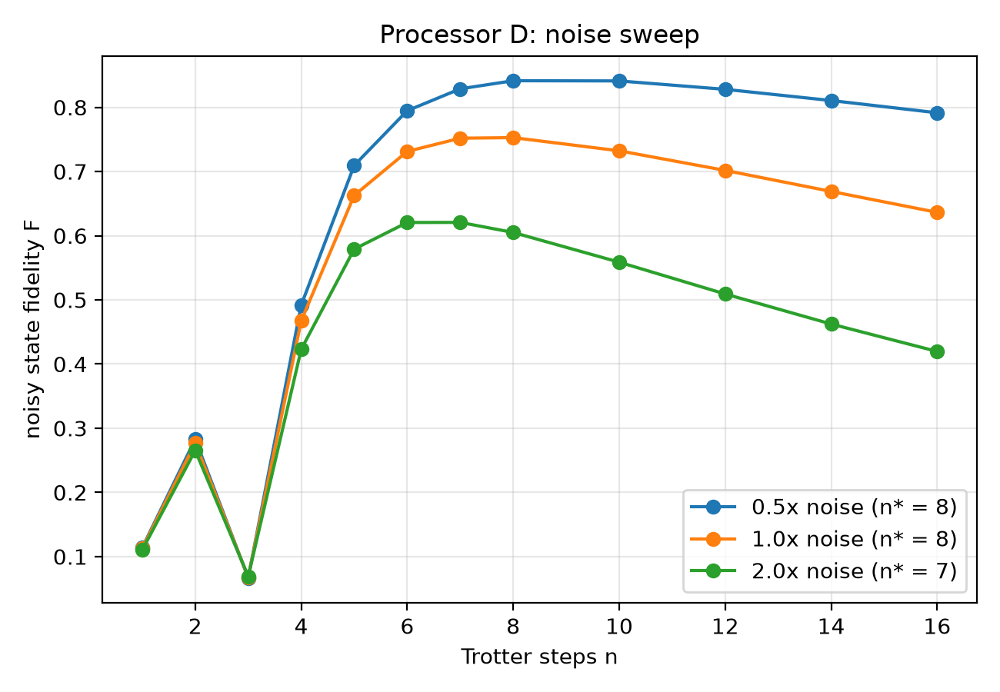
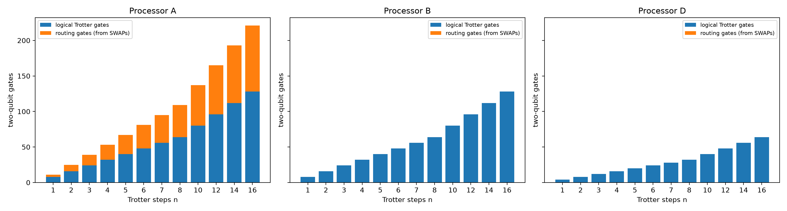
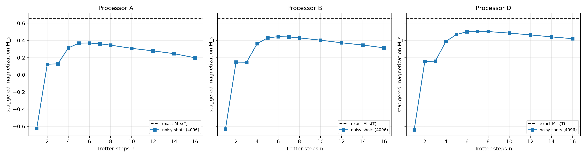
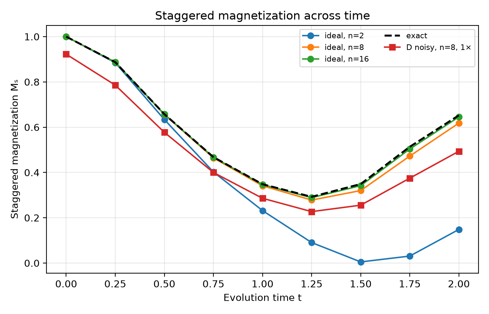
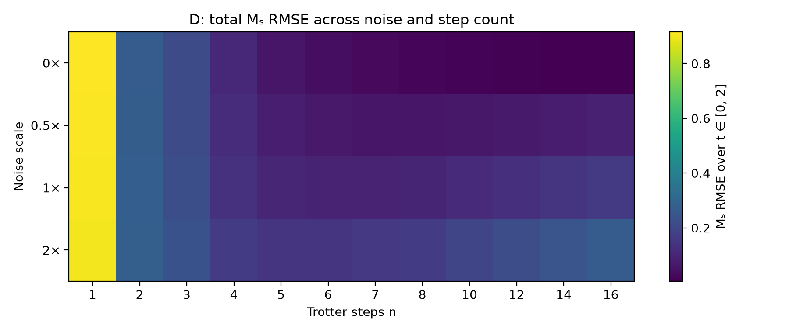

# PS-S3 — Trotter error versus noise

**QFF 2026 Phase 2 · Team: Entangled Minds**

## Executive result

For the locked four-spin ring at \(J=g=1\), starting from the Néel state
`1010` and evolving to \(T=2\), the best tested first-order Trotter step
counts under the official 1× noise model are \(n^*=6\) on Processor A,
\(n^*=7\) on B, and \(n^*=8\) on D. The corresponding noisy state
fidelities are 0.5774, 0.6628, and 0.7528. On D, the optimum moves from
8 steps at 0.5× noise to 7 steps at 2× noise. D's combination of ring
connectivity and native RZZ reduces both routing overhead and logical
two-qubit gate count in this simulated benchmark.

These are maxima over the required discrete scan, not claims about a
continuous or hardware optimum. All processors use the same synthetic
per-gate noise rates; D does not win because it was assigned better rates.

## 1. Method and locked settings

The Hamiltonian is
\[
H=-J\sum_{i=0}^{3}Z_iZ_{(i+1)\bmod 4}-g\sum_{i=0}^{3}X_i
\]
with \(J=g=1\). The initial state has \(Z_i=(-1)^i\), represented by
Qiskit's `1010`. We apply first-order Trotter steps of duration
\(\Delta t=T/n\), with the even ZZ bonds before the odd bonds (including the
ring-closing bond), then the X layer. The tested values are
`1, 2, 3, 4, 5, 6, 7, 8, 10, 12, 14, 16`.

The exact state at \(T=2\) is computed from the organizer's locked ring
operator; the pipeline checks that operator against
`qff_sim.tfim_hamiltonian(periodic=True)`. Its exact staggered magnetization
is \(M_s=0.65244\). Required noisy fidelity is the density-matrix overlap
with this exact state (gate noise only, no readout noise). \(M_s\) is
estimated separately from 4,096 noisy Z-basis shots and includes readout
noise. The official settings are \(p_1=0.001\), \(p_2=0.005\), readout
bit-flip probability 0.01, seed 42, and transpiler optimization level 1.
Processors A/B use `rz/sx/x/cx`; D uses the permitted `rz/sx/x/rzz` basis
with the same two-qubit error rate. The official utility module is unchanged.

## 2. Objective 1 — Bell-state verification on D

The circuit prepares \(|\Phi^+\rangle\) with H and CX. We test the adjacent
physical pair (0, 1), distance 1, and the farthest pair (1, 5), distance 4.
For each pair and ideal/noisy condition, the three correlations use 4,096
shots each. Fidelity and its standard error use the organizer's required
correlation formula.

| Pair | Distance | Condition | Two-qubit gates | XX | YY | ZZ | Fidelity |
|---|---:|---|---:|---:|---:|---:|---:|
| (0, 1) | 1 | ideal | 1 | 1.0000 ± 0.0000 | −1.0000 ± 0.0000 | 1.0000 ± 0.0000 | 1.0000 ± 0.0000 |
| (0, 1) | 1 | noisy | 1 | 0.9463 ± 0.0051 | −0.9468 ± 0.0050 | 0.9463 ± 0.0051 | 0.9598 ± 0.0022 |
| (1, 5) | 4 | ideal | 10 | 1.0000 ± 0.0000 | −1.0000 ± 0.0000 | 1.0000 ± 0.0000 | 1.0000 ± 0.0000 |
| (1, 5) | 4 | noisy | 10 | 0.9038 ± 0.0067 | −0.8867 ± 0.0072 | 0.9248 ± 0.0059 | 0.9288 ± 0.0029 |

Noise lowers the measured correlations and therefore lowers the fidelity;
the effect is larger for the distant pair because its routed circuit uses
10 two-qubit gates instead of 1. With the same per-gate noise model, those
additional operations create more opportunities for depolarizing error.
The far-pair result remains above 0.92, but is measurably worse than the
adjacent-pair result. These are simulated-noise results, not hardware data.

## 3. Objective 2 — Processor D design

D is a connected six-qubit graph with edges
`(0,1), (1,2), (2,3), (3,0), (3,4), (4,5)`. Qubits 0–3 form the interaction
ring, so the four-spin PS-S3 circuit fits without routing SWAPs; the tail
provides a distance-4 pair for the Bell experiment. Its native basis is
`rz/sx/x/rzz`. It assumes the official error rates (0.001/0.005/0.01);
the official checker accepts the graph, basis, rates, and justification.

The measured bottleneck is clear at each processor's 1× optimum. A uses
11 SWAPs and incurs 33 extra two-qubit gates (81 total versus 48 logical);
B routes no SWAPs but requires 56 logical CX gates; D routes none and
requires 32 logical RZZ gates. Thus the proposed connectivity removes the
ring-routing overhead seen on A, while its native RZZ basis halves the
logical two-qubit count relative to a CX-RZ-CX construction. The trade-off
is an unvalidated hardware assumption: RZZ is treated as a native gate with
the same two-qubit error rate as CX. The tail does not help the ring
simulation, and the distance-4 Bell circuit still incurs routing cost.

## 4. Objective 3 — PS-S3 results

### 4.1 Step scan and \(n^*\)

| Processor | \(n^*\) | Noisy \(F(n^*)\) | Noise-free Trotter \(F(n^*)\) | Noisy \(M_s(n^*)\), shots ± SE |
|---|---:|---:|---:|---:|
| A | 6 | 0.5774 | 0.8642 | 0.3698 ± 0.0104 |
| B | 7 | 0.6628 | 0.9144 | 0.4409 ± 0.0105 |
| D | 8 | 0.7528 | 0.9417 | 0.5032 ± 0.0105 |

### 4.2 Crossover: Trotter error versus noise

The noise-free Trotter fidelity improves substantially at fine steps (from
0.1150 at \(n=1\) to 0.9900 at \(n=16\)), but a denser circuit also accumulates
more gate noise. The measured noisy fidelity therefore has a maximum at an
intermediate scan point. Coarse-step values are not strictly monotonic—the
finite-time evolution has coherent Trotter error, so interference can make
neighboring coarse discretizations better or worse. From the broad increase
in the low-to-intermediate range, the trend turns down at larger \(n\), when
additional noisy gates outweigh the remaining Trotter-error reduction.

The noise-free fidelity at each processor's noisy optimum remains above its
noisy fidelity, as expected. D reaches the highest noisy optimum in this
model: it has no routing overhead and a smaller logical two-qubit count,
despite using the same official per-gate rates. This conclusion is specific
to the four-qubit ring, this time, this gate model, and the specified noise;
it is not a general ranking of physical devices.

### 4.3 Noise sweep on D

| Noise scale | \(n^*\) | Fidelity at \(n^*\) |
|---:|---:|---:|
| 0.5× | 8 | 0.8415 |
| 1× | 8 | 0.7528 |
| 2× | 7 | 0.6207 |

Doubling all three rates moves the selected optimum one tested point lower,
from 8 to 7, because the cost of additional steps grows faster. At 0.5× the
curve is nearly flat at its maximum: \(F(8)=0.8415\) and \(F(10)=0.8411\);
the specified smallest-step tie rule selects 8. The 1× and 0.5× optima
coincide on this grid, so the movement is not asserted to be smooth.

### 4.4 Gate split and connectivity

For a ring Trotter step, a CX-based ZZ construction uses eight logical
two-qubit gates (four bonds × two CX gates). D uses four RZZ gates per step.
A's tree connectivity cannot embed the four-cycle, so transpilation adds
routing gates: at \(n=1\), it has 8 logical plus 3 routing gates, and at
\(n=16\), 128 logical plus 93 routing gates. B embeds the ring with zero
routing overhead but retains the CX construction. D embeds the ring and
uses the native RZZ construction. At the selected optima, the measured
totals and depths are 81/100 (A), 56/78 (B), and 32/57 (D), where the first
value is total two-qubit gates and the second is full circuit depth.

### 4.5 Staggered magnetization from shots

At the selected optima, noisy shot estimates are below the exact
\(M_s=0.65244\): A gives \(0.3698\pm0.0104\), B gives
\(0.4409\pm0.0105\), and D gives \(0.5032\pm0.0105\). The one-standard-error
bars quantify finite-shot uncertainty only; they do not capture model
uncertainty or the bias from gate/readout noise. Therefore, a small
statistical error must not be interpreted as accuracy relative to the exact
state.

### 4.6 Bonus — readout-error correction

At D's 1× optimum (\(n=8\)), symmetric readout correction changes
\(M_s\) from 0.50317 to 0.51167. The calibration measured an attenuation
factor of 0.9834 from an all-zero circuit and cost 4,096 additional shots.
The correction addresses the assumed independent symmetric readout flips
only; it does not mitigate gate noise. The corrected value remains below
the exact 0.65244, so this one-point result is not evidence that the full
noise bias has been removed.

## 5. Resource metrics on A, B, and D

The table below gives resource metrics at each processor's 1× optimum.
`resources.csv` contains the same metrics for all 12 tested step counts on
each processor (36 rows total).

| Processor | Steps | Logical 2Q | Routing overhead | Total 2Q | SWAPs | Depth | 2Q depth |
|---|---:|---:|---:|---:|---:|---:|---:|
| A | 6 | 48 | 33 | 81 | 11 | 100 | 57 |
| B | 7 | 56 | 0 | 56 | 0 | 78 | 28 |
| D | 8 | 32 | 0 | 32 | 0 | 57 | 16 |

These are transpiled circuit metrics, not wall-clock hardware durations.
They show that A's ring-routing overhead grows with step count; at \(n=16\)
it reaches 93 extra two-qubit gates (221 total). B has no routing overhead
for this embedding, while D combines zero routing with fewer logical gates
through its RZZ basis.

### Supplementary time-resolved error decomposition

To make the trade-off auditable beyond the required endpoint fidelity, we
also evaluated the locked Hamiltonian at nine times from \(t=0\) to \(2\)
for every tested step count. The raw `s3_error_analysis.csv` records the
exact, ideal-Trotter, and noisy density-matrix \(M_s(t)\), pointwise
Trotter/noise/total absolute deviations, fidelities, state-vector error,
noise trace distance, and the \(T=2\) transpiled depth/gate count.
`s3_error_summary.csv` reports RMSE across these nine times. The three
observable errors are measured separately; total error is computed directly
against the exact observable and is not inferred by adding the other two.

| Processor / noise | Lowest-\(M_s\)-RMSE steps | \(M_s\) total RMSE | Trotter RMSE | Noise-induced RMSE | Depth at selected steps | 2Q gates |
|---|---:|---:|---:|---:|---:|---:|
| A / 1× | 5 | 0.16180 | 0.06163 | 0.11111 | 83 | 67 |
| B / 1× | 6 | 0.12755 | 0.04004 | 0.09440 | 67 | 48 |
| D / no noise | 16 | 0.00487 | 0.00487 | 0.00000 | 113 | 64 |
| D / 0.5× | 8 | 0.06049 | 0.02097 | 0.04312 | 57 | 32 |
| D / 1× | 6 | 0.09482 | 0.04004 | 0.06148 | 43 | 24 |
| D / 2× | 5 | 0.14492 | 0.06163 | 0.09495 | 36 | 20 |

This observable-based optimum is intentionally **not** substituted for
official \(n^*\): PS-S3 defines its headline \(n^*\) as the maximum noisy
state fidelity at \(T=2\), which is \(n=8\) on D at 1×. The supplementary
minimum is \(n=6\) for the time-averaged \(M_s\) RMSE on D at 1×. They answer
different questions, so the step-count recommendation depends on the
specified metric. At no noise, D's \(M_s\) RMSE decreases across the scanned
grid to 0.00487 at \(n=16\); at 2× noise, the observable RMSE is lowest at
\(n=5\) and increases for finer steps in this tested range.

These nine-time-point observables are deterministic density-matrix
expectations with gate noise only; `readout_included=false`, `shots=0`, and
there is no shot-sampling standard error in this supplementary analysis.
The required endpoint \(M_s\) table remains the separate 4,096-shot result.

## 6. Trade-offs, limitations, and next improvements

- This is a simulator-only synthetic noise model, with the same rates on all
  processors (0.001/0.005/0.01 at 1×); the D 1× result is \(F=0.7528\).
  It does not represent calibrated hardware or connectivity-dependent gate
  quality, so the ranking is not a hardware-performance claim.
- The result covers one four-spin Hamiltonian, one initial state, one
  evolution time, first-order Trotterization, and a finite discrete step
  grid. The D 0.5× maximum is shallow (\(F(8)=0.8415\) versus \(F(10)=0.8411\));
  a finer scan around \(n=7\)–10 could resolve it, while additional times and
  system sizes would test generality.
- Density-matrix fidelity includes gate noise but excludes readout by
  definition, while shot-based \(M_s\) includes readout. At D's \(n=8\),
  \(F=0.7528\) but \(M_s=0.5032\) versus exact 0.6524; these metrics should
  not be conflated.
- The RZZ advantage depends on the assumed native-gate cost and error rate.
  Here D uses 32 two-qubit gates at depth 57 versus B's 56 at depth 78.
  A hardware-informed follow-up should use measured RZZ duration/error,
  calibration variation, and a broader gate/depth benchmark.
- Readout correction used one symmetric calibration factor. A fuller study
  shifted \(M_s\) only from 0.5032 to 0.5117 after 4,096 extra shots, still
  0.1408 below exact. A fuller study would compare calibration uncertainty,
  a per-qubit assignment model, or zero-noise extrapolation and report the
  full sampling overhead.

## 7. Reproducibility and artifacts

Run `python s3_pipeline.py` or restart and run all cells in `main.ipynb`.
The scan took about eight seconds in the recorded local run; runtime depends
on the machine. The environment recorded in
[`results/environment.json`](results/environment.json) is Python 3.12.10,
Qiskit 1.4.6, Qiskit Aer 0.18.0, NumPy 2.4.6, SciPy 1.17.1, pandas 3.1.0,
and Matplotlib 3.11.2. The official seed is 42, shot count 4,096, and
optimization level 1.

The required CSV schemas are present in `results/tables/`; `s3_scan.csv`
contains 60 rows (12 step counts × five processor/noise groups),
`s3_summary.csv` contains the five corresponding maxima, and
`resources.csv` contains 36 processor/circuit rows. The Bell and mitigation
tables contain four and one rows respectively. The exact data operator,
Processor D checker, table columns, and locked settings come from the
organizer's Phase 2 challenge kit. AI assistance is disclosed in
[README.md](./README.md).

## 8. AI assistance disclosure

GitHub Copilot was used in this final audit, for a targeted progress-log fix,
and to prepare this report and the README. The reported results were generated
by running the project pipeline and checked against the challenge table
schemas and Processor D rules. Any AI tools used before this final audit must
also be added by the team before submission; no unsupported claim about prior
tool use is made here.
